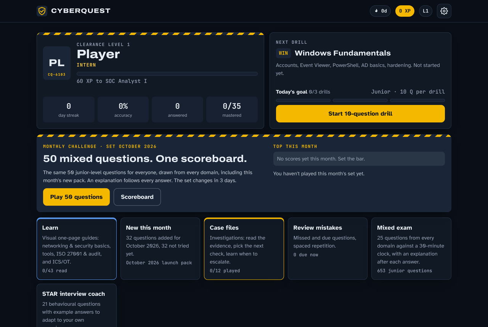
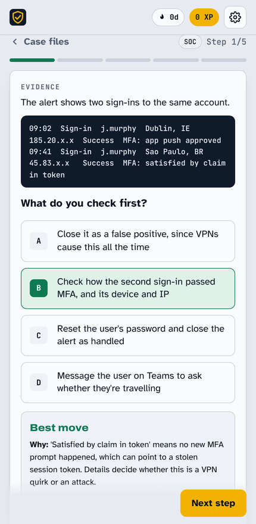
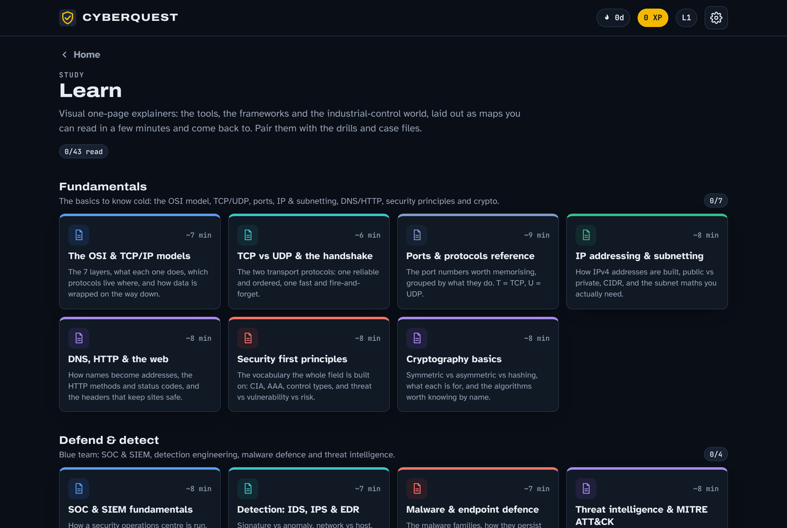
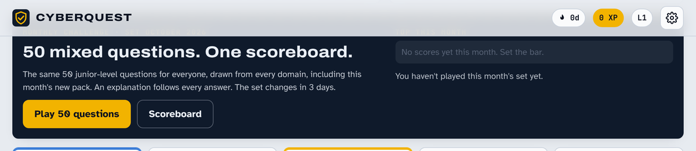
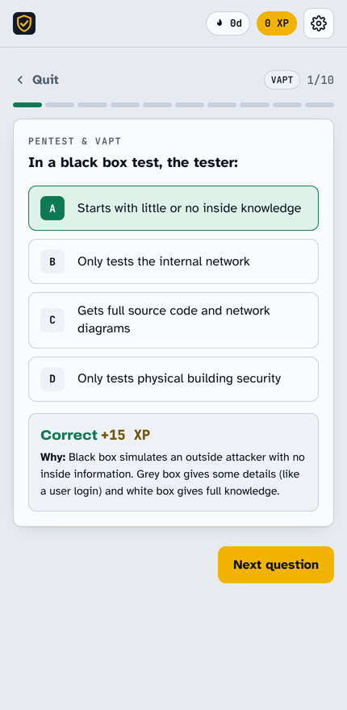

<div align="center">

# 🛡️ CyberQuest

**A gamified cybersecurity trainer — drills, case-file investigations, visual study sheets, a monthly challenge with a scoreboard, and a STAR interview coach.**

Built for people in their first years in security: SOC analysts, GRC and compliance analysts, pentesters and anyone moving into the field.




</div>

---

## What is it?

CyberQuest turns cybersecurity revision into something you'll actually come back to. It's a single self-contained web app (no front-end framework) that installs on your phone, tablet or desktop as a Home Screen app and works offline. Every question in every mode is followed by an explanation, so you learn whether you got it right or wrong.

It ships in **two forms from one codebase**: a full **Netlify** build (with accounts, a shared scoreboard and push reminders) and a **single-file build** for static hosting.

- **~940 multiple-choice questions** across **35 modules**, every answer explained
- **Junior / Mixed / Advanced** difficulty — pitched for 0–2 years' experience by default
- **12 case-file investigations** — read the evidence, pick your next move, learn *when to escalate*
- **43 visual "Learn" sheets** — one-page infographics across 8 tracks (networking, defend, respond, offense, cloud, GRC, ICS/OT, tools)
- **Monthly Challenge** — the same 50 questions for everyone each month, with a server-verified scoreboard
- **STAR interview coach** — 21 behavioural questions with example answers
- **Spaced repetition**, XP, levels, streaks and a daily goal
- **Accounts** so friends get their own progress, and **4-hour push reminders**

---

## Features

### 🎯 Drills & spaced repetition
Pick a module and run a quick drill. Wrong answers and due questions come back automatically on a spaced-repetition schedule (Leitner-style boxes), so revision targets what you keep forgetting. A **Junior / Mixed / Advanced** switch changes the question pool, and you can pin up to 8 **focus areas** (e.g. the skills in a job advert) that next-drill suggestions lean towards.

### 🧩 Case files
Realistic, branching investigations where the answer isn't obvious. At each step you see the evidence (sometimes raw log lines), choose your next check, and get told whether it was the **best move, a reasonable one, or a poor one — and why**. Each case closes with what to take away, *when to seek help*, and how to tell it as an interview story.



### 📚 Learn — visual study sheets
43 one-page, infographic-style references across eight tracks that mirror the field: **Fundamentals** (OSI/TCP-IP, TCP vs UDP, a full ports table, subnetting, DNS/HTTP, crypto), **Defend & detect**, **Respond & recover**, **Offense & AppSec**, **Cloud & identity**, **GRC & audit**, **Specialist & ICS/OT**, and the **Tools** stack. Each sheet has colour-coded panels, numbered steps, tables and a *Save / print* button (print just the sheet as a PDF).



### 🏆 Monthly Challenge & scoreboard
50 mixed junior-level questions, the **same set for every player** in a calendar month (picked deterministically from the bank). Scoring rewards accuracy, speed and streaks. When you post a score the server **rebuilds the set, re-checks every answer against the bank and recomputes the score**, so made-up numbers are rejected. Each player keeps their best run.



### 🗣️ STAR interview coach
21 behavioural questions with worked example answers to adapt to your own experience, a 2-minute speaking timer, and a self-check.

### 📱 Installable PWA with reminders
Add it to your Home Screen on iPhone, iPad or desktop. It works offline, and (on the Netlify build) sends a Web Push reminder every few hours pointing at one of your weakest modules.

<p>

</p>

---

## How it works

CyberQuest is deliberately **framework-free** — it's vanilla HTML, CSS and JavaScript, so it's fast, tiny and easy to read. A small build step stitches one source into two targets.

```
         data/*.js  ──┐
  src/shell.html  ────┤      node build.mjs       ┌──►  public/index.html   (Netlify PWA)
  src/app.js  ────────┼───────────────────────────┤
  src/challenge.js ───┘   validates every          └──►  dist/cyberquest-artifact.html
                          question, then builds           (single-file build)
                                   │
                                   └──►  netlify/lib/{cqc,bank,modules}.mjs
                                        (so the scores function re-checks runs server-side)
```

- **One source, two builds.** `build.mjs` validates all content (4 distinct options, an explanation ≥ 40 chars, well-formed case files and Learn blocks) and fails the build if anything is off. It then emits the Netlify page, the single-file artifact, and the shared modules the serverless functions use to verify scores.
- **Serverless backend (Netlify Functions + Blobs).** Accounts, per-account progress, the scoreboard, push subscriptions and the monthly reminder are small Functions v2 handlers; state lives in Netlify Blobs. No database to run.
- **Security-minded by default.** Passwords hashed with scrypt; session tokens stored only as hashes behind an `HttpOnly; Secure; SameSite` cookie; login lockout and sign-up rate limiting; same-origin checks on writes; a strict Content-Security-Policy.

### Tech stack
`Vanilla JS` · `HTML/CSS` · `Node (build)` · `Netlify Functions v2` · `Netlify Blobs` · `Web Push (VAPID)` · `Service Worker / PWA`
Runtime dependencies: just `@netlify/blobs` and `web-push`.

---

## Project structure

| Path | What it is |
|---|---|
| `src/app.js` | The whole app: state, views, drills, cases, Learn, challenge, STAR, accounts |
| `src/shell.html` | HTML shell + all CSS; placeholders the build fills in |
| `src/challenge.js` | Monthly-challenge engine (shared with the server so both agree on the set) |
| `src/sw.js`, `src/manifest.webmanifest` | Service worker (offline + push) and PWA manifest |
| `data/*.js` | Question bank, STAR stories, case files and Learn sheets — one file per domain |
| `data/packs/` | Monthly question packs (`YYYY-MM.js`) |
| `netlify/functions/` | `auth`, `progress`, `scores`, `subscribe`, `reminder`, `vapid`, `calendar` |
| `netlify/lib/` | Shared helpers + build-generated `cqc.mjs` / `bank.mjs` / `modules.mjs` |
| `build.mjs` | Validates content and builds both targets |
| `public/` | The built, deployable site (served by Netlify) |
| `netlify.toml` | Netlify config + security headers |

---

## Run locally

```bash
npm install
node build.mjs          # builds public/index.html and dist/cyberquest-artifact.html
npx netlify-cli dev     # full experience with Functions, at http://localhost:8888
```

For just the static app, open `public/index.html` after building (accounts, scoreboard and reminders need the Functions).

## Deploy to Netlify

Push reminders and accounts need Netlify Functions, so deploy with the CLI or Git (a drag-and-drop deploy publishes the static app only).

```bash
npm install
npx netlify-cli login
npx netlify-cli deploy --build --prod
```

Or connect the repo in Netlify (**Add new project → Import from Git**); settings come from `netlify.toml`, and every push redeploys. Optionally set an `INVITE_CODE` environment variable to make sign-ups invite-only.

---

## Adding content

Everything is data. Each module in `data/*.js` looks like this (a fifth element `"j"` marks a junior-level question):

```js
QB.push({ id: "iso", code: "ISO", name: "ISO/IEC 27001:2022", group: "GRC · ISO 27001", blurb: "...", q: [
  ["Question?", "Correct answer", ["Wrong 1", "Wrong 2", "Wrong 3"], "Why the answer is right.", "j"],
]});
```

- **Case files** live in `data/14-cases-*.js` — five decisions each, every option graded best / reasonable / poor with a reason.
- **Learn sheets** live in `data/15–25-learn-*.js` as a small block grammar (`split`, `steps`, `table`, `grid`, `flow`, `timeline`, `callout`, `note`, `list`, `lead`).
- The build **validates everything** and refuses to ship malformed content, so you can't accidentally publish a question with no explanation or a table with mismatched columns.

---

## Accounts & privacy

Each player signs in with a username and password (no email required) and gets their own progress, synced across devices. Passwords are hashed with scrypt; only a hash of each session token is stored. There's a one-time recovery code for password resets. A **guest mode** works with no account (progress stays on that device). Reminders and scoreboard posting require an account.

## Install as an app

1. Open the site in **Safari** (iOS/iPadOS 16.4+) or Chrome/Edge (desktop/Android).
2. **Share → Add to Home Screen** (or install from the address bar).
3. Open it from the icon, then turn on reminders.

---

## Acknowledgements

Built as a personal learning project. Question content reflects widely published standards and frameworks (ISO 27001, NIST CSF, SOC 2, PCI DSS, GDPR, MITRE ATT&CK, OWASP, the CIS Controls); always check primary sources before quoting specifics in an audit.

## License

Released under the [MIT License](LICENSE). The code is free to use and adapt. The question content is provided for learning; attribution is appreciated.
